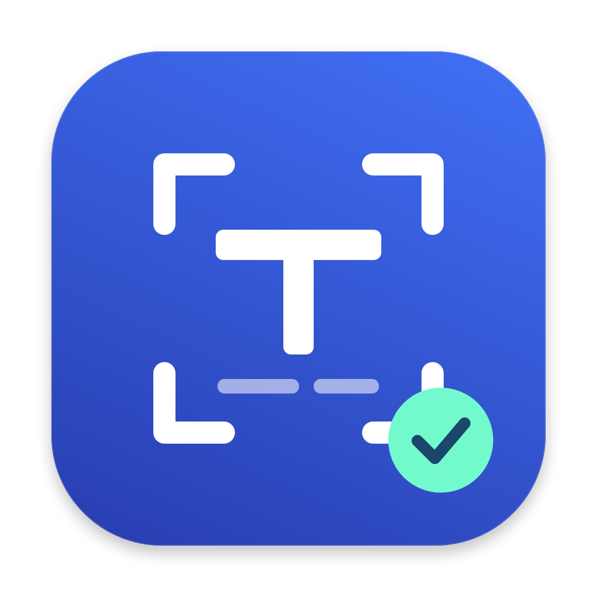

# ocrsnip

📷 **macOS 菜单栏截图工具** — 快捷键框选屏幕区域,自动识别文字或将截图置顶显示。

```bash
⌘⇧2  →  框选区域  →  自动 OCR  →  ⌘V 粘贴
⌘⇧3  →  框选区域  →  截图置顶  →  拖动；悬停后滚轮缩放
```

## 安装

1. 从 [Releases](https://github.com/HuangYincan/ocrsnip/releases) 下载 `ocrsnip.dmg`
2. 双击打开,将 `ocrsnip.app` 拖入 **Applications** 文件夹
3. 首次打开需授权: **系统设置 → 隐私与安全性 → 辅助功能 + 屏幕录制**（授权后请完全退出再打开；之后不应再反复弹窗）。菜单栏打开「开机自启」后，若系统要求确认，请在 **系统设置 → 通用 → 登录项** 中允许 ocrsnip。

从 **v0.3.0** 起，应用带有独立图标和应用内更新。默认每天自动检查新版本，也可以在菜单栏点击「检查更新…」。发现更新后按提示下载安装并重启，无需卸载、重新拖入 Applications；菜单中的「自动检查更新」可以关闭后台检查。旧版 v0.2.x 尚无更新器，需要先手动覆盖安装一次 v0.3.0。



更新包和版本索引都经过 Ed25519 签名校验，下载失败或校验失败不会替换应用。更新需要重启，置顶截图不会跨重启保留。应用设置会保留；屏幕录制、辅助功能权限能否沿用取决于应用代码签名身份是否稳定。从 v0.3.0 起本地和 GitHub 发布统一使用固定证书；从旧版临时签名切换时需要重新授权一次。

GitHub 构建尚未使用 Apple Developer ID 签名和公证。从 v0.3.0 起，发布流程使用固定的 ocrsnip 自签名证书，并在发布前校验应用及其更新辅助程序的证书指纹；校验失败会停止发布。首次打开仍可能被 Gatekeeper 阻止。确认来源是本项目后，先尝试打开一次，再到 **系统设置 → 隐私与安全性 → 仍要打开** 放行。

### 提示“已损坏，无法打开”

v0.2.1 的发布包遗漏了完整应用签名。请从本项目 Releases 下载新版，覆盖安装到 Applications，不要执行 `codesign --sign -` 重新签名；该命令会把固定证书身份改成临时签名，使已有屏幕录制授权失效。

确认下载来源是本项目后，先尝试打开一次，再到 **系统设置 → 隐私与安全性 → 仍要打开** 放行。此方式不会更改应用的签名身份。

### 能框选，但置顶图是黑块、OCR 没有结果

先检查屏幕录制权限。更新或重新签名后，旧权限记录可能仍绑定旧签名，即使系统设置中的开关看起来已开启，也无法读取屏幕内容。将「系统设置 → 隐私与安全性 → 屏幕与系统音频录制（或屏幕录制）」中的 ocrsnip 关闭再开启，然后完全退出并重新打开应用。若仍无效，移除旧条目，再用“+”添加 `/Applications/ocrsnip.app` 并开启权限。

截图和框选前会检查屏幕录制权限，未授权时停止本次捕获，并显示「请求授权」及「打开系统设置」按钮。只有点击「请求授权」才发起系统授权，期间不会显示框选遮罩；授权并重启后再次按快捷键即可截图。已授权时不重复请求。OCR 仅在识别到文字且成功写入剪贴板后播放完成声音；没有声音不一定是快捷键或音频故障。

本地开发请用 `zsh scripts/build.sh` 打包。脚本只接受与 `signing/ocrsnip.cer` 匹配的固定证书，本地与 GitHub 发布使用同一私钥。钥匙串缺失原证书时构建会停止，不会自动生成另一张证书。首次签名时钥匙串可能询问是否允许 `codesign` 使用该证书；无需把自签名证书加入系统信任根。对外分发若需要免手动放行，可另外迁移到 Apple Developer ID 并公证。

## 使用

| 操作 | 效果 |
|------|------|
| 按 **⌘⇧2** | 鼠标变成十字准星,框选区域并 OCR，文字写入剪贴板 |
| 按 **⌘⇧3** | 框选区域,截图窗口置顶显示,可自由拖动 |
| 鼠标悬停置顶截图后滚轮 | 以指针位置为锚点缩放该截图 |
| 按 **Esc** 或 **双击** 置顶截图 | 关闭该截图 |
| 菜单栏 **📷** 图标 | 可手动触发、关闭全部置顶截图、开关开机自启或退出 |
| 菜单栏 **开机自启** | 登录 macOS 时自动打开 ocrsnip（勾选即开） |
| 菜单栏 **检查更新…** | 检查版本，按提示下载、安装并重启 |
| 菜单栏 **自动检查更新** | 开关每日后台版本检查，选择会保留 |

OCR 识别期间菜单栏显示 ⏳；听到快门声表示文字已写入剪贴板并读回确认，此时可按 ⌘V 粘贴。写入失败会自动重试，最多 3 次。未识别到文字或失败时仅显示通知，不播放完成提示音。

> 注意：⌘⇧3 是 macOS 自带的全屏截图快捷键。程序会通过辅助功能事件监听拦截 ⌘⇧2 / ⌘⇧3；如果没有响应，请在“系统设置 → 隐私与安全性 → 辅助功能”中允许 ocrsnip，并完全退出后重新打开。若不允许辅助功能，也可以关闭系统自带的 ⌘⇧3，此时会回退到 Carbon 热键。

| 层 | 技术 |
|---|---|
| 语言 | Swift 6 |
| OCR 引擎 | Apple Vision (VNRecognizeTextRequest) |
| 截图 | ScreenCaptureKit（macOS 15.2+）/ screencapture 回退 |
| 界面 | 菜单栏图标 (NSStatusItem) |
| 热键 | CGEventTap（全局 ⌘⇧2 / ⌘⇧3）+ Carbon 回退 |
| 自动更新 | Sparkle 2，签名更新索引及安装包 |

## 构建

```bash
zsh scripts/build.sh
open dist/ocrsnip.app
```

固定证书的公开部分保存在 `signing/ocrsnip.cer`，私钥保存在维护者钥匙串及获准配置的 GitHub Actions secret 中。缺少私钥的其他开发者可以显式设置 `OCRSNIP_ALLOW_ADHOC=1 OCRSNIP_SIGN_IDENTITY=-` 进行隔离测试构建，但该构建不能通过正式更新打包校验。

构建脚本下载并校验固定版本的 Sparkle，嵌入框架和安装辅助程序，然后从内到外签名整个应用。首次构建需要网络，之后复用 `.build` 缓存。不要只编译裸二进制，否则缺少图标、更新配置和框架。图标源文件为 `scripts/draw-icon.swift`，运行 `zsh scripts/build-icon.sh` 可重新生成各尺寸图标。

发布自动更新的密钥配置、打包和验证步骤见 [应用内更新发布说明](docs/updates.md)。

运行 OCR 回归测试：`zsh scripts/test-ocr.sh`。加 `--integration` 可测试真实 Vision 识别及独立的 macOS 测试剪贴板，不改动日常剪贴板。

## 许可

MIT
